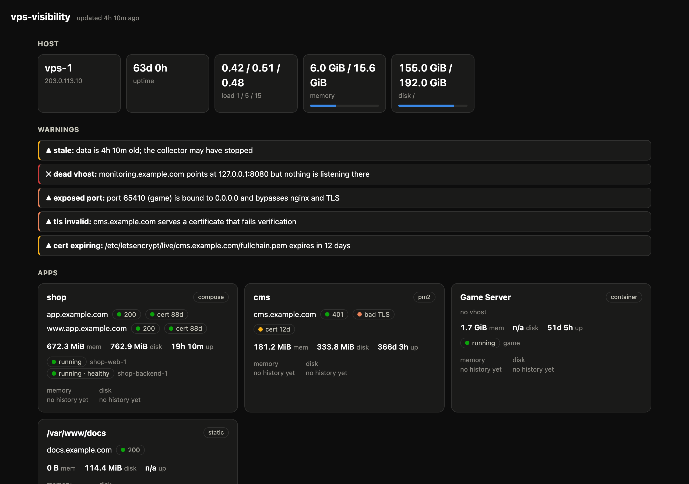

# vps-visibility

One dashboard for a hand-rolled VPS. It reads your nginx config, Docker and
PM2, joins them, and answers at a glance what SSH archaeology answers today:

- which apps are live, behind which domains, and whether HTTPS actually works
- which vhosts are dead (proxying to a port nothing listens on)
- which ports are exposed to the internet, bypassing nginx and TLS
- how much memory and disk each app uses, and its trend over the last weeks
- how old each deployment is, when each TLS cert expires
- Telegram messages when a domain goes down, recovers, a container disappears
  or restarts, disk or memory crosses a threshold, or a cert nears expiry

Zero runtime dependencies: a Python 3 (3.8+) standard-library collector on a
cron, one static HTML page served by the nginx you already run, JSON files in
between. No agents, no database, no Node, no pip installs.

## Install

On the VPS, as root:

    git clone https://github.com/gauravkrp/vps-visibility /opt/vps-visibility
    cd /opt/vps-visibility
    sudo bash setup.sh

The installer asks for a dashboard domain, basic auth credentials, and an
optional Telegram bot token. It then writes `/etc/vps-visibility/config.json`,
an nginx vhost, and a cron entry (every 5 minutes), runs the collector once,
prints the exact DNS A record to add, waits for DNS, and runs certbot for TLS.

Prompts can be pre-answered with env vars for unattended installs:
`VV_DOMAIN`, `VV_AUTH_USER`, `VV_AUTH_PASS`, `VV_TG_TOKEN`, `VV_TG_CHAT`,
`VV_DATA_DIR`, `VV_CERT_EMAIL`, `VV_SKIP_TLS=1`.

Passwords and tokens are still masked when the installer prompts for them
interactively. For `VV_AUTH_PASS`, avoid putting the plaintext password
directly on the command line since your shell will keep it in
`~/.bash_history`; read it from a file instead:

    VV_AUTH_PASS="$(cat /root/.vv-pass)" bash setup.sh

Telegram setup: message @BotFather, `/newbot`, copy the token; then message
your new bot once and open `https://api.telegram.org/bot<token>/getUpdates`
to read your chat id.

## How it works

A cron job runs `collector/collect.py` every 5 minutes:

1. Parse `/etc/nginx/sites-enabled/` for server blocks (domains, upstreams,
   cert paths). Certbot-managed files with multiple blocks are handled.
2. Ask Docker (`ps`, `inspect`, `stats`), PM2 (`jlist`) and the kernel
   (`ss -tlnp`, `/proc`) what is actually running.
3. Join: domain -> upstream port -> container or PID -> app. Vhosts pointing
   at silent ports become dead-vhost warnings; public listeners that bypass
   nginx become exposed-port warnings.
4. Probe every domain over HTTPS from localhost (SNI + Host header, cert
   verification on) and TCP-check every upstream.
5. Write `current.json` and a slim history line, prune history past the
   retention window, diff against the previous run, and send Telegram alerts
   on transitions only (down after 2 consecutive failures, recovery, restarts,
   disappearances, threshold crossings, expiring certs).

The dashboard is one static page reading those JSON files, served by your
nginx behind basic auth and TLS. If the collector dies, the page says so
("data is N old"), because staleness is computed client-side.

## Configuration

`/etc/vps-visibility/config.json` (mode 0600). Defaults shown; every key
optional except where the installer fills it:

| Key | Default | Meaning |
|---|---|---|
| `dashboard_domain` | none | Domain the dashboard is served on |
| `data_dir` | `/var/lib/vps-visibility` | Where JSON state and history live |
| `retention_days` | `14` | History files older than this are deleted |
| `probe_via` | `localhost` | `localhost` probes 127.0.0.1 with SNI; `public` goes through DNS |
| `public_ip` | auto-detected | Shown on the dashboard |
| `filesystems` | `["/"]` | Mounts to report and threshold-check |
| `thresholds.disk_pct` | `90` | Alert when a filesystem crosses this |
| `thresholds.mem_pct` | `90` | Alert when host memory crosses this |
| `thresholds.cert_warn_days` | `14` | Warn when a cert is this close to expiry |
| `telegram.bot_token` | none | Leave null to disable alerts |
| `telegram.chat_id` | none | Your chat with the bot |
| `app_overrides` | `[]` | `{match, dir, label}`; `match` is the app name, exact, case-insensitive |

## Security notes, honestly

- The collector runs as root via cron. It needs the Docker socket, nginx
  config, and `du` into app directories. Reduced-privilege alternative: run it
  as a user in the `docker` group and accept missing disk numbers for
  root-owned directories plus no `ss` process names.
- The dashboard and its JSON reveal internal ports and paths, so everything
  sits behind basic auth; certbot runs with `--redirect`, so HTTP is forced to
  HTTPS and auth never crosses the wire in plaintext.
- Secrets (Telegram token, htpasswd) live only on the VPS in `/etc/vps-visibility`,
  mode 0600/0640. Nothing secret is ever written into this repo.
- `setup.sh` is short on purpose. Read it before you run it as root.

## Limits (by design)

nginx only (Apache/Caddy/Traefik vhosts are not parsed; their apps still
appear via Docker/PM2 as "no vhost"). One server per install. Light history,
not a metrics platform: if you outgrow it, run Netdata or Beszel alongside.
No restart buttons: the page is static and read-only.

## Uninstall

    sudo bash /opt/vps-visibility/uninstall.sh

Removes the cron entry and vhost; leaves config and data for you to delete.

## Development

    python3 -m pytest tests/ -v          # pytest is the only dev dependency
    ln -s ../sample-data dashboard/data  # then: cd dashboard && python3 -m http.server 8090

MIT licensed. Issues and PRs welcome.
